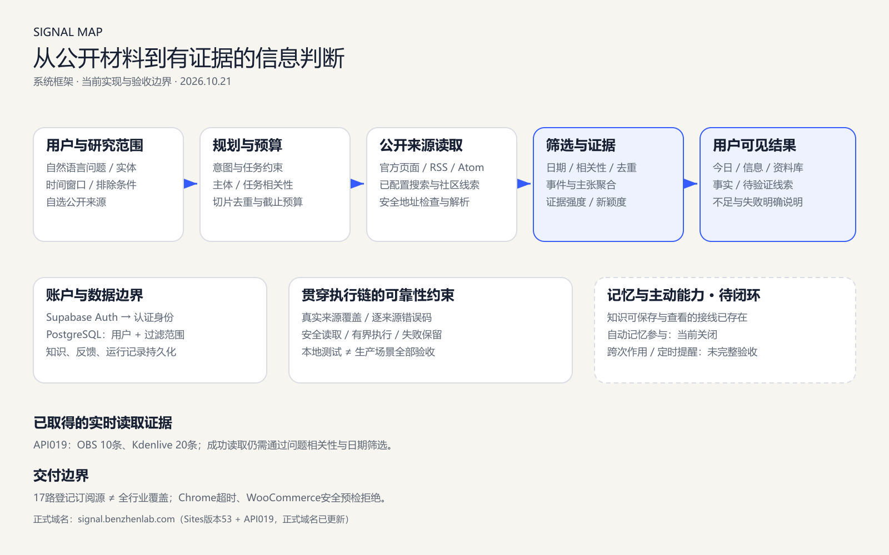

<!-- README_SYNC: source=eb6666d5a46c1cf42647840a7601c211e2c7e12e; updated=2026-10-22 -->
<p align="center">简体中文 · <a href="./README_EN.md">English</a></p>

# Signal Map

面向独立开发者和创作者的信息筛选工具：围绕具体问题读取公开来源，按日期、相关性和证据筛选，并说明没有得出结论的原因。

[Star 收藏](https://github.com/xiebenzhen-code/signal-map/stargazers) · [试用入口](https://signal.benzhenlab.com/) · [问题反馈](https://github.com/xiebenzhen-code/signal-map/issues)


**当前为受限试用。** 仓库目前私有，需要访问权限才能克隆；不展示无法公开核验的 Star 数、CI 成功或许可证徽章。

[约50秒真实操作视频](docs/portfolio/signal-map-demo.mp4) · [录制方法与结果](docs/portfolio/DEMO.md)



## 为什么做这个工具

关注一个产品时，难点不只是找到文章，还要判断它是否回答了当前问题、是否仍在时间范围内、是不是已经知道的消息。

Signal Map 将这条工作流做成有边界的工具：

- **围绕问题检索**：把主体、时间窗口和排除条件转成计划，按预算及截止时间执行。
- **从材料走向证据**：读取官方更新、RSS/Atom和已配置渠道，再做日期、任务相关性、去重与事件聚合；发布时间不与抓取时间混用。
- **记录实际执行**：来源已搜索、未搜索和失败分别记录；多轮历史不会被末轮“未搜索”覆盖，读取失败保留安全的细分错误码。
- **允许证据不足**：没有足够材料时可返回零结果，但零结果不代表没有变化。相关性误拒仍是已知问题。

适合关注特定产品、创作工具和公开技术动态；不承诺全网覆盖、每次必有答案、持续自主监控或成熟公共 SDK。

## 信源与行业范围

[来源目录](source-registry/feed-catalog.ts)登记 **17路订阅源，其中11路为官方发布方**。每次按实体或主题最多选3路订阅，另有既有检索路径。登记、成功读取和事实可信是不同状态。

| 方向 | 已登记来源 | 边界 |
|---|---|---|
| 影视与创作软件 | Kdenlive、OBS、Krita | 软件发布和工具变化，不覆盖整个影视产业 |
| 电商与独立站 | Shopify、WooCommerce | 开发者更新不自动等于商家政策或适用性结论 |
| 编程与开源 | Node.js、GitHub、Mozilla、Chrome | 各渠道可达性和验证程度不同 |
| AI 产品 | OpenAI | 不构成完整 AI 行业覆盖 |
| 中文资讯与社区 | IT之家、少数派、机核、阮一峰、InfoQ、开源中国 | 文章仍需核对原始来源、日期和任务相关性 |
| 航天与天文 | NASA | 读取成功不代表每条材料都与问题相关 |

开发记录中，IT之家、少数派、NASA、Shopify、Krita、OBS、Kdenlive共7路具有历史云端读取与解析成功证据，不代表持续稳定。最近记录的 Chrome/FeedBurner 超时、WooCommerce 地址预检拒绝尚无恢复证据。AI＋教育等方向尚缺专用来源和行业验收。

## 实现与验收状态

Web：React / vinext；API：Node.js；认证：Supabase Auth；账户持久化：PostgreSQL。

```text
问题、时间窗口与排除条件
  → 检索规划 / 预算 / 截止时间
  → 来源读取 / 安全检查 / RSS 或 Atom 解析
  → 日期与任务相关性 / 去重 / 证据聚合
  → 今日、信息与资料库
```

主要接口包括 `POST /api/signals`、`POST /api/research/plan`、`/api/research/stream`、`/api/control/knowledge`、`POST /api/sources/check`。这些是产品内部接口，不是稳定公共 SDK；`sources/check` 当前是网页模式，不能代替 Feed 模式验收。

| 能力 | 已有证据 | 尚未完成 |
|---|---|---|
| 来源读取与过滤 | 有限真实读取、确定性测试和执行日志 | 全行业覆盖、持续可达性及答案质量 |
| 账户记录持久化 | 测试账号接口保存、退出重登读回、浏览器显示新记录 | 更多账号、设备和范围验收 |
| 同浏览器账号切换 | `130009a` 本机草稿隔离修补及本地反例 | 新版本部署后 A→B→A 页面复验 |
| 登录后体验 | 已登录 `/control` 直回首页的代码与测试 | 新版本正式站点复验 |
| 长期记忆影响研究 | 存储和选择接线存在，自动参与默认关闭 | 跨次记忆作用的完整闭环 |
| 主动跟踪与提醒 | 有调度和通知相关实现 | 不作为当前已验收生产承诺 |

截至本次文档核对，最后记录的正式版本为 **Sites53 + API019**；包含 `130009a` 和测试时钟修正 `eb6666d` 的站点更新仍记录为阻断。**GitHub 最新代码不等于已经在线上运行。**

### 演示没有掩盖的失败

2026-10-21，正式站点的 Kdenlive 维护更新问题检索20条、聚合18个信号、最终展示0条。读取确实执行了，但没有回答原题，答案质量未通过。视频保留真实结果，采用实际浏览器逐帧采集、等待段2倍速、无音轨，不冒充原生高帧率连续录屏。

## 本地运行

建议 **Node.js 24+**。包声明最低22.13.0，但完整测试参数需要更高版本，记录中的全量门禁使用 Node.js 24。以下为 PowerShell 命令，克隆需要仓库访问权限。

```powershell
git clone --branch fix/stability-closeout-20261019 https://github.com/xiebenzhen-code/signal-map.git
Set-Location signal-map
npm ci
if (!(Test-Path .env.local)) { Copy-Item .env.example .env.local }
```

先编辑 [.env.example](.env.example) 的本机副本。认证需要 `NEXT_PUBLIC_SUPABASE_URL` 和 `NEXT_PUBLIC_SUPABASE_PUBLISHABLE_KEY`；账户持久化需要自己的 `DATABASE_URL` 及对应数据库表。模型和可选渠道按需配置；数据库迁移入口 `npm run db:migrate` 只对自己专用的开发库执行。

真实研究可能访问外部服务并产生模型或云费用。不要用生产数据库测试，不提交 `.env.local`、密码、Cookie或密钥。打开本地页面不代表认证、数据库或外部信源已经可用。

第一个终端启动 API，默认端口8080：

```powershell
npm run api:build
node --env-file=.env.local dist-api/server.mjs
```

第二个终端启动 Web。原生 Node 模式无需托管平台身份：

```powershell
$env:SIGNAL_MAP_FRONTEND_RUNTIME = "node"
$env:API_UPSTREAM_URL = "http://127.0.0.1:8080"
npm run dev -- --hostname 127.0.0.1 --port 3000
```

打开[本地页面](http://127.0.0.1:3000)。前端代理到本机 API，账户服务仍依赖正确配置。生产代理与信源读取保留地址和 Origin 检查，不应为联网问题关闭保护。

## 测试与工程记录

```powershell
npm run quality
npm run build
npm run api:build
```

最近已记录门禁对应 `eb6666d`：**912项，906通过、0失败、6项因数据库测试环境缺失跳过**，quality/build退出0；包含 typecheck、lint、knip和依赖检查，lint仍有28个既有警告。这是历史执行记录，不是本次 README 编辑重新运行的结果；测试数量不是覆盖率或真实用户研究次数。

仓库有手动触发的[端到端工作流](.github/workflows/signal-map-agent-loop-e2e.yml)，需要专用测试环境，不以文件存在代替 CI 实际通过。

- [README 事实核对记录](docs/verification/readme-evidence-20261022.md)
- [可编辑架构 SVG](docs/portfolio/signal-map-architecture.svg)：图中状态反映当时记录。
- [API019 发布与诊断](docs/verification/api-repair-release-20261021.md)
- [OBS / Kdenlive 云端读取](docs/verification/other-feeds-cloud-probe-20261021.md)
- [正式域名与演示交付](docs/verification/formal-portfolio-delivery-20261021.md)
- [本机账号隔离修补记录](docs/verification/local-account-isolation-repair-20261021.md)

## 数据、许可与反馈

服务端账户记录与本机草稿是两条路径。最新源码为每个账号绑定独立 IndexedDB 存储，并保留匿名旧库；无归属历史数据不自动分配给登录账号。该修补线上复验尚未完成，共享设备勿保存敏感草稿。页面看到了知识，不等于知识已经影响研究。

仓库尚无项目级 `LICENSE`，不在这里声明 MIT、开源或商业使用许可。第三方依赖和字体有各自许可。

请通过[Issue](https://github.com/xiebenzhen-code/signal-map/issues)提供脱敏请求编号、时间、版本与预期行为，不提供凭据。项目对你有参考价值时，可以[Star 收藏](https://github.com/xiebenzhen-code/signal-map/stargazers)。仓库访问范围保持不变。
