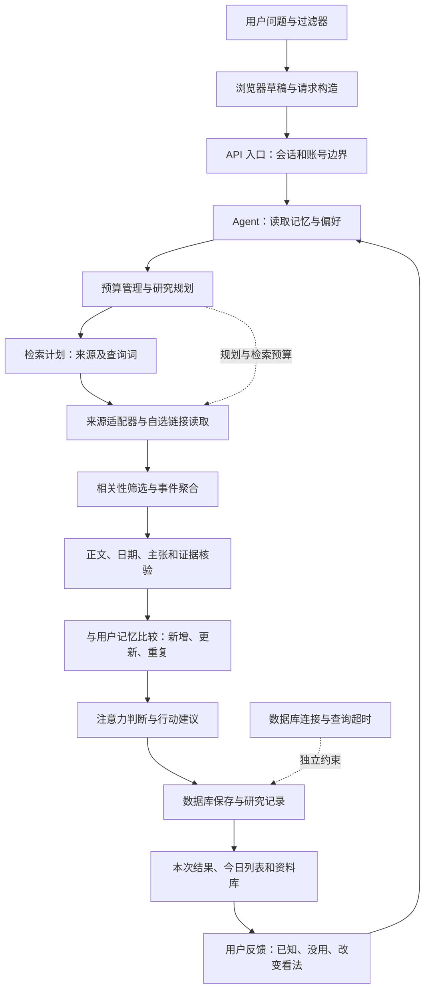

# 从 Signal Map 学习 AI 产品开发与落地

日期：2026-10-04。代码基线：HEAD `110d904` 加当前工作区修补；未提交的工作区不等于可追溯的正式发行版本。

本文结合本次读取的实际代码、仓库验收报告和国内官方招聘页。历史验收只代表当时的场景，不代表线上版本或长期稳定性。其他项目采用截至 2026-10-03 的历史记录，未在本轮重跑。

## 1. 先理解产品承诺

Signal Map 的目标是：围绕用户的问题获取材料，核对相关性、时间和证据，结合用户已经知道的内容，决定什么值得关注，并保留依据和反馈。它不是“搜到多少就展示多少”的搜索页，也不是能自行训练模型的系统。

需要分开回答四个问题：材料能读吗？与问题相关吗？证据够吗？对这个用户有新价值吗？它们的答案不能相互替代。

## 2. 一次研究的中文架构图

图表示逻辑职责。实际执行有多轮、降级和提前停止，并不是每次请求都完整走完所有节点。追踪一次失败时，应按阶段日志确定已经走到哪里。BudgetManager 主要约束规划与检索；知识写入不是由它逐项强制截断，数据库有独立连接/查询超时，因此不能把 25 秒规划检索 deadline 描述成端到端耗时的硬保证。

## 3. 每一环为什么存在

以下路径均相对仓库根目录，可在编辑器里直接定位。

| 环节与代码入口 | 输入 → 输出 | 设计理由 | 去掉后的问题 | 你的学习题 |
|---|---|---|---|---|
| 页面 `app/page.tsx` | 问题、筛选、反馈 → 用户操作 | 让人能理解结果和参与判断 | 技术接口可用，但用户无法使用或理解 | 研究失败后，旧卡片应该怎样标识？ |
| 请求构造 `information/research-request.ts` | 浏览器认知与配置 → ResearchInput | 把界面状态转换为明确契约 | 换题时旧实体、旧缺口可能进入新请求 | 找出问题、时间窗、自选来源的传递位置 |
| 草稿存储 `lib/alpha-storage.ts` | 当前过滤器改动 → IndexedDB | 刷新保留；事务内合并防并发覆盖 | 保存来源可能覆盖刚写的反馈 | 解释“读旧快照再写全表”为什么丢数据 |
| 路由与代理 `app/api/signals/route.ts`、`backend/api-proxy.ts` | 同源 HTTP → Node 后端 | workerd 无法直接满足 pg 的原始 TCP 连接需求 | 前端运行正常，数据库接口却不可用 | HTTP 代理、数据库连接、浏览器地址各是什么？ |
| 服务入口 `backend/node-server.ts`、`backend/handlers.ts` | 请求与会话 → 研究执行 | 统一身份、校验、超时及错误表达 | 账号混用、错误含糊、无界调用 | 200、completed、agent 成功为何不能混为一谈？ |
| Agent `agent/runner.ts` | 目标、记忆、偏好 → 有界研究与最终评估 | 系统依据目标与结果决定执行和停止 | 只剩固定搜索，没有反馈或停止控制 | 找到规划、执行、核验、停止的真实分支 |
| 预算 `agent/budget-manager.ts` | deadline → 可执行时间及阶段守卫 | 为检索留下时间，避免规划耗尽预算 | 模型思考成功，检索却来不及启动 | 解释 25 秒总预算与 8 秒规划上限的关系 |
| 规划与契约 `agent/query-planner.ts`、`agent/retrieval-plan.ts`、`research/query-planner.ts` | 问题 → 研究计划及 RetrievalPlan | 正常页面链的 runner 生成计划并转换后交检索；语义规划与执行分工，便于替换 Provider | 下游重复规划，查询意图漂移 | 哪些字段属于计划，哪些属于执行结果？ |
| 来源注册 `source-registry/sources.json` | 实体别名、域名、入口 → 来源候选 | 将维护数据与筛选逻辑分开 | 新实体找不到对应来源 | 为什么登记 Adobe 首页不等于证实某篇文章？ |
| 安全读取 `source-enrichment/custom-source.ts`、`doh-resolver.ts` | URL → 正文、日期或明确失败 | 公网校验、地址钉定、TLS、重定向逐跳校验共同防 SSRF | 用户链接可能访问内网；解析成功也可能连错地址 | DoH 改的是解析路径，为什么守卫仍须保留？ |
| 检索与相关性 `research/research-pipeline.ts`、`topic-relevance.ts` | 原始候选 → 相关材料 | 来源适配器可以宽搜，后续严格核对主题 | “release”一词让无关版本都通过 | 设计一个与 AI 剪辑无关的 Release 反例 |
| 内容与证据 `content-processing/`、`agent/evaluation.ts` | 正文 → 主张、核验及不足 | 页面标题、站点权威、文章事实是不同层次 | 首页列表壳冒充事实；未知条件被补造 | 原文存在但核验不足时，应放哪里？ |
| 记忆比较 `agent/evaluation.ts`、`knowledge-updater.ts` | 新证据＋旧记录 → 新增/更新/重复 | 记录“见过”与“已核验”，阻止无意义修订 | 重复证据推进修订，或更强证据被压制 | 同主张、同 URL、同强度该如何分类？ |
| 注意力与呈现 `information/today-selection.ts` | 信号 → 今日/资料库 | 留存与优先展示分开，控制注意力 | 入库被误称为“值得读”；零今日被误称零证据 | Adobe 入库但今日为零，是技术失败还是价值未通过？ |
| 持久化 `information/repositories/postgres.ts`、`backend/postgres.ts` | 证据与知识 → 账号隔离的数据库记录 | Repository 隔离业务与数据库，TLS 保证传输信任 | 配置冲突悄悄改 TLS；空日期覆盖有效日期 | 解释 upsert、唯一约束及 COALESCE |
| 反馈 `backend/feedback-records.ts`、`backend/control-plane.ts` | 按钮 → 账号记录 → 下一轮输入 | 判断与事实分流；失败提示与真实保存一致 | “改变看法”被当成“不感兴趣”或已验证事实 | 找到保存成功、失败、草稿保留的区别 |

## 4. 关键取舍，也要认识它的局限

- **规则与模型协作**：模型参与规划；安全边界、数据契约、去重及不少筛选由代码控制。好处是可复现、可解释；代价是规则维护与隐晦问题适配不足。
- **浏览器草稿与账号知识分开**：IndexedDB 便于本地恢复；Postgres 支持账号跨会话。自选来源目前仍是浏览器过滤器范围，不能声称跨设备同步。
- **有界降级**：模型超时可以走已有确定性计划；失败、未搜索、证据不足必须分开。降级是保住可信结果，不是保证有答案。
- **来源与证据分开**：官方域名是归属依据，不能单凭品牌或首页权威分给文章强行升分。当前 Adobe 场景没有通过“今日可读更新”的价值验收。
- **学习与记忆分开**：持久化反馈和下一轮消费属于应用级适应；尚无本项目自主更新模型参数的证据，也没有长期用户效果证明。
- **模块存在与功能上线分开**：scheduler 的租约/续跑和 notification 的去重有测试；生产触发及投递接线缺失。现在不承诺自动推送。
- **工程复杂度要解释**：独立 Node 后端是当前运行时需要；并非所有项目都应照搬这一分层。700 多测试也不能代替少量真实用户完成任务。

## 5. 中文术语表

| 词 | 中文与在本项目中的含义 |
|---|---|
| Agent / Agent Loop | 智能体／执行循环：围绕目标规划、调用工具、核验结果并决定停止 |
| Provider / Adapter | 来源提供方／适配器：把不同外部接口转成统一材料 |
| Evidence / Claim | 证据／主张：某个说法及支持它的原始材料 |
| Memory | 记忆：账号记录和用户输入，并非训练后的模型记忆 |
| Novelty | 新颖度：相对用户已有认知的新信息量 |
| Repository | 仓储接口：业务访问持久化数据的边界 |
| Trace / requestId | 过程轨迹／请求编号：把页面、接口和阶段日志关联起来 |
| E2E | 端到端验收：真实入口一直到目标结果，需明确是本地还是线上 |
| SSRF / DNS pinning | 服务端请求伪造／地址钉定：防内网访问，并固定校验后实际连接的地址 |
| TLS / CA / SNI | 加密传输／受信证书机构／握手主机名：三者共同支撑连接信任 |
| CI/CD / Rollback | 持续集成交付／回滚：自动验证并安全发布、恢复上一版 |

## 6. 国内岗位对照与方向筛选

检索日期：2026-10-04。以下采用用人方官方页面；岗位可能变化，学历和年限条件需要另行核对个人履历。它们用于能力对照，不等于投递资格或录用预测。

| 官方岗位样本 | 主要要求（简述） | 你的项目证据与缺口 | 判断 |
|---|---|---|---|
| [腾讯 Agent 开发工程师 R108051](https://tencent.wd1.myworkdayjobs.com/zh-CN/Tencent_Careers/job/Agent_R108051-1) | 全栈交付、记忆与工具、评测和生产保障；要求较多研发经验 | Signal Map 有对应模块与修复案例；个人独立编码掌握程度、线上评测和运维仍需证明 | 作为技术能力标尺，不直接宣称已胜任资深岗 |
| [腾讯 AI Agent 开发工程师（游戏研发）R107498](https://tencent.wd1.myworkdayjobs.com/zh-CN/Tencent_Careers/job/AI-Agent--_R107498-2) | 创作研发流程工具集成、效果评估、AI Native 开发；涉及游戏引擎能力 | 视频与视觉项目支持创作场景叙述；没有证据证明 UE 插件或 C++ 实践 | 可借鉴创作工具方向，当前不主攻引擎工程岗 |
| [腾讯微信小店产品策划—商家客服](https://careers.tencent.com/jobdesc.html?postId=2097166275703910400) | 用户需求、服务效率、反馈与数据分析；AI 技术背景为加分 | 需要用真实用户完成任务和反馈数据证明价值，不能只展示模块和测试数 | 产品开发/落地的学习重点很匹配，业务经验需另核对 |
| [腾讯智能体商业化产品经理—CodeBuddy/WorkBuddy](https://careers.tencent.com/jobdesc.html?postId=2101490875808002048) | 商业化产品、计费交易、转化验证及 SaaS 经验 | 尚无支付、营收或商业化实证；目前只适合参考成本和价值指标 | 后续方向，暂不作为主要作品定位 |

上述判断是对有限样本和已有作品的推断，不代表整个国内就业市场。建议主线：**AI 产品开发与落地，技术重点是 Agent 应用与全栈交付，场景重点是信息与创作工具**。纯模型训练/强化学习算法岗暂不作为主线；“AI Native”应落实为工程和产品能力，而不是只会让 AI 写代码。

## 7. 多项目怎样形成一条主线

| 项目 | 在组合里的作用 | 应展示什么 | 不应声称什么 |
|---|---|---|---|
| Signal Map | 主要工程案例 | 有界研究、证据、记忆与反馈、真实故障定位、上线试用结果 | 全行业可用、自主学习、生产规模稳定 |
| AI Daily Vlog Agent | 创作工作流案例 | 素材到剪辑、实际时长与字幕对齐、去重、人工审片标准 | 解码成功即剪辑好；尚未通过的人类审片结论 |
| Visual Ancestry / Frame Atlas | 体验与信息架构案例 | 内容优先界面、检索与创作意图、移动端体验 | 本地验证即已发布；审美人格自动推断 |

其他项目来自历史记录，当前版本可能已变化。先核对现状再写简历。不要把它们现在合并成一个更大的 Agent：组合表达即可。

## 8. 四周学习安排（以每周实际产物验收）

| 周 | 核心内容 | 用现有项目练什么 | 合格标志 |
|---|---|---|---|
| 第 1 周 | TypeScript、对象/数组、类型、async/await、HTTP | 自己画一次问题到响应的调用链；跟读请求类型和 handler | 不看 AI 解释，讲清输入、输出、异常和身份边界；能读懂相关测试 |
| 第 2 周 | SQL、唯一键、upsert、事务、账号隔离、记忆 | 解释日期回填与同强度重复；在离线测试里改变输入并预测结果 | 先写预期再运行，能解释一次红→绿及每个断言 |
| 第 3 周 | Agent 规划、工具调用、预算、安全与评测 | 读规划超时和 DoH 案例；整理固定成功/失败样本 | 能区分模型错误、网络错误、证据不足和呈现错误，并提出最小检查 |
| 第 4 周 | 部署、日志、回滚、用户访谈、价值指标 | 完成受控试用并复盘用户失败任务 | 有线上版本证明、匿名化问题记录和至少一项真实用户价值判断 |

每天 45–90 分钟：先自己解释 10 分钟，再读代码/案例 20 分钟，做一个离线练习 20 分钟，最后写 5 句复盘。不会的术语单独记，不扩大产品功能。若第 1 周基础不足，应延长，而不是靠 AI 完成任务当作自己掌握。

第一课就读 `app/api/signals/route.ts` → `backend/api-proxy.ts` → `backend/handlers.ts` → `agent/runner.ts`。回答：请求为什么要代理？用户身份何时确定？预算谁管理？失败在何处转成页面提示？
